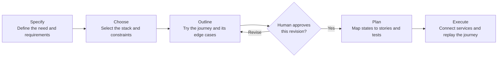

# SCOPE

**Try the product journey before building the backend. Keep the version you approved as the reference for delivery.**

A product requirements document (PRD) describes what the team intends to build. Decisions made while trying the prototype can get lost when engineers turn that document into stories and tests.

SCOPE is a product development workflow for teams working with AI agents. Product and engineering can try the journey with simulated data, agree on what users should see, and reuse the prototype’s components as real services come online.

## From need to release

An independent reviewer checks the prototype against the full PRD, including requirements the demo may have missed. Human approval identifies the exact revision engineering will use. An open technical question can still block the story that depends on it.

## From a requirement to an acceptance test

- **PRD.** “I want to arm my alarm from my watch.” What should I see if the connection drops after I tap *Arm*?
- **Prototype decision.** Show *Armed* only after the alarm confirms. If the connection drops first, show *Status unknown*.
- **Story and test.** Handle loss of connection while confirmation is pending. Send the request, disconnect before the reply, and verify that the watch shows *Status unknown*. [Try the simulation](https://jeremiep69.github.io/scope-showcase/)

## What works today

- **Change impact.** When a requirement or prototype decision changes, SCOPE uses recorded dependencies to identify affected screens, copy, stories and tests.
- **Design system.** The prototype and its component gallery use the same UI sources. A UI catalogue records which journeys use each component and state.
- **Feature and API discovery.** A feature catalogue links existing capabilities to delivered stories. API contracts and data dependencies help engineers find an existing operation and see which consumers a change may affect.
- **Workflow reporting.** SCOPE can report recorded duration and token usage. The method is still being validated. Reducing rework, delivery time and token consumption are goals with no published benchmarks.

## Design influences

Role-based collaboration draws on [BMAD Method](https://github.com/bmad-code-org/BMAD-METHOD). Turning requirements into a delivery plan draws on [Spec Kit](https://github.com/github/spec-kit).

Two ideas shaped the handoff to engineering. Separating UI components from sample data lets the team reuse the approved interface when it connects live services. Checking the delivered behaviour against evidence gives the reviewer a way to challenge a completion claim. These ideas draw on [Design OS](https://github.com/buildermethods/design-os) and [Superpowers](https://github.com/obra/superpowers), respectively.
