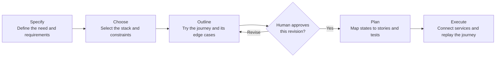
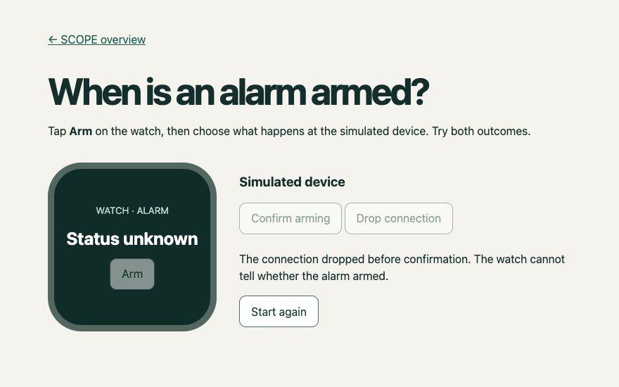

# SCOPE

**Try the product journey before building the backend. Keep the version you approved as the reference for delivery.**

A requirement can sound clear in a product requirements document (PRD) and still leave a team guessing. When someone taps a button on a watch, does a check mark mean the tap registered, or that the remote device acted? That distinction changes the interface, the API and the acceptance test.

SCOPE is a product development workflow for teams working with AI agents. Product and engineering can try the journey with simulated data, agree on what users should see, and reuse the prototype’s components as real services come online.

## From need to release

An independent reviewer checks the prototype against the full PRD, including requirements the demo may have missed. Human approval identifies the exact revision engineering will use. An open technical question can still block the story that depends on it.

## One decision on a watch

**[Try the interactive example](https://jeremiep69.github.io/scope-showcase/)** · A standalone simulation with fictional devices and data.

| PRD requirement | Prototype state | Delivery story | Acceptance test |
| --- | --- | --- | --- |
| Show when the alarm confirms arming. | Tap **Arm** → **Waiting** → **Armed** on confirmation. | Connect the status view to the device response. | Delay the response. The watch stays in **Waiting** until confirmation arrives. |
| Tell the wearer when the outcome is unknown. | Tap **Arm** → **Waiting** → **Status unknown** on disconnect. | Handle a lost connection while a request is pending. | Disconnect before confirmation. The watch shows **Status unknown**. |

If a team changes the confirmation rule, SCOPE uses recorded dependencies to identify affected screens, copy, stories and tests. The team can review that list before changing the shared status component.

## What works today

- **Design system.** The prototype and its component gallery use the same UI sources. A UI catalogue records which journeys use each component and state.
- **Feature and API discovery.** A feature catalogue links existing capabilities to delivered stories. API contracts and data dependencies help engineers find an existing operation and see which consumers a change may affect.
- **Workflow reporting.** SCOPE can report recorded duration and token usage. The method is still being validated. Reducing rework, delivery time and token consumption are goals with no published benchmarks.

SCOPE draws on BMAD Method for role-based collaboration, Spec Kit for requirements and planning, Design OS for reusable prototypes, and Superpowers for independent verification.
